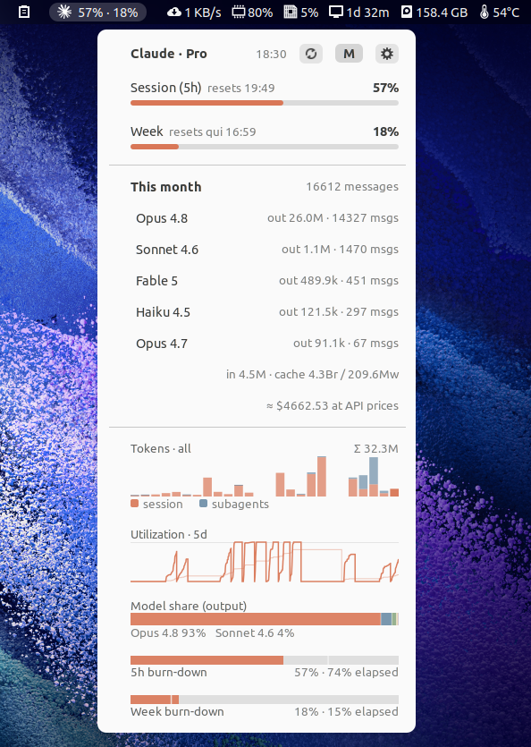

# Claude Code & Codex Usage

GNOME Shell panel indicators for your Claude and Codex subscription rate‑limit
utilization and your Claude Code / Codex token usage and estimated
API‑equivalent cost: one panel button per provider, each with its own
preferences (one tab per button; the price table is shared). The Codex button
appears only when Codex is signed in (`~/.codex/auth.json`).

<p align="center">
  
</p>

> **Unofficial**: not affiliated with or endorsed by Anthropic or OpenAI.
> "Claude" and the Claude logo are trademarks of Anthropic, "Codex" and the
> Codex logo of OpenAI, used here only to identify the services the extension
> reports on.

## ⚠️ GNOME Shell 42 only

This is built in the **legacy (pre‑45) extension format** and imports
**libsoup 2.4**, so it runs on **GNOME Shell 42** (tested on 42.9) and will
**not** load on GNOME 45+ (which require the ESM module format) or where only
libsoup 3 is present. No newer‑GNOME port is provided.

## Features

- Panel readout: 5‑hour and weekly utilization, and/or today's cost.
- Dropdown: utilization bars, a Day/Week/Month/Year summary with per‑model
  breakdown and cost, optional per‑project totals, and optional graphs (daily
  tokens, utilization trend, model share, 5‑hour burn‑down).
- Codex: the weekly‑limit resets still available, a weekly bar per app your
  plan is shared with ("Sign in with ChatGPT" apps draw on the same limit),
  and a utilization trend that starts from the history in the session logs.
  When the usage request fails, the bars fall back to the newest utilization
  the logs recorded.
- Everything is toggleable and reorderable in Preferences, including which
  model families the summary and the model‑share graph list.

Codex totals combine two sources. The per‑model rows, cost and projects come
from the local session logs; the account's daily token totals from the server
add a "Not in local logs" row and graph series, which holds runs such as
`codex exec --ephemeral` (no session log) and other surfaces. Shared‑plan apps
report only a percentage, so their tokens appear in neither. Codex cost uses
OpenAI's API prices, including the long‑context rate above 272K input tokens
and twice the price for fast mode; `codex-auto-review` has no published price.
A price change re‑prices the transcripts still on disk and keeps the totals of
deleted ones.

## Privacy

Reads locally, sends nothing but the requests below:

- `~/.claude/.credentials.json`: the OAuth access token only, sent over HTTPS
  to `https://api.anthropic.com/api/oauth/usage` to fetch your utilization.
- `~/.codex/auth.json`: the ChatGPT access token and account id only, sent over
  HTTPS to `https://chatgpt.com/backend-api/wham/usage` (the endpoint Codex's
  `/status` uses), `/wham/usage/chatpass/apps` (apps the plan is shared with)
  and `/wham/profiles/me` (tokens per day) to fetch your utilization. The token
  is never refreshed or written.
- `~/.claude/projects/**/*.jsonl` and `~/.codex/sessions/**/*.jsonl`:
  transcripts and session logs, parsed locally for token/cost totals; their
  contents never leave your machine.

No telemetry, no other network access.

## Install

```sh
git clone <this-repo> claude-usage@tiago
cp -r claude-usage@tiago ~/.local/share/gnome-shell/extensions/
glib-compile-schemas ~/.local/share/gnome-shell/extensions/claude-usage@tiago/schemas/
# Reload: Alt+F2 → "r" → Enter (X11), then:
gnome-extensions enable claude-usage@tiago
```

## License

GPL‑2.0‑or‑later — see [LICENSE](LICENSE).
